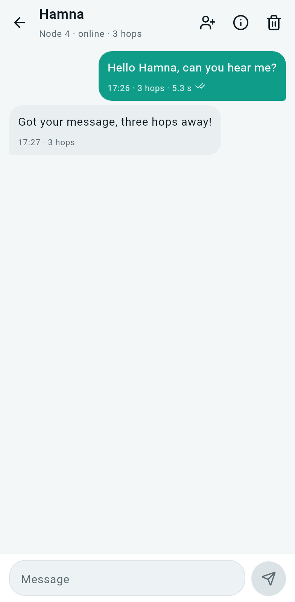
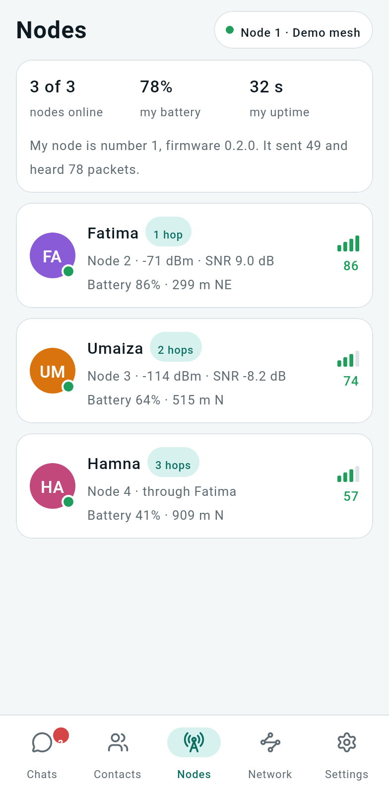
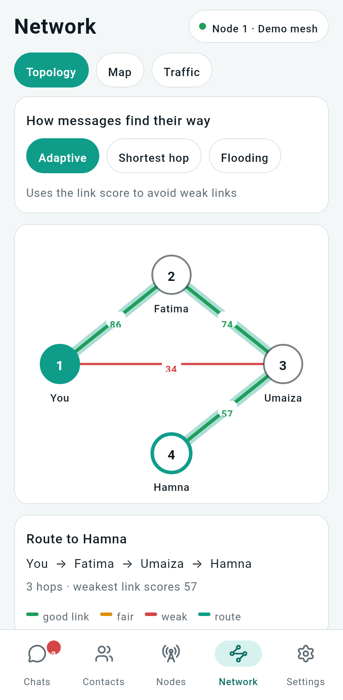
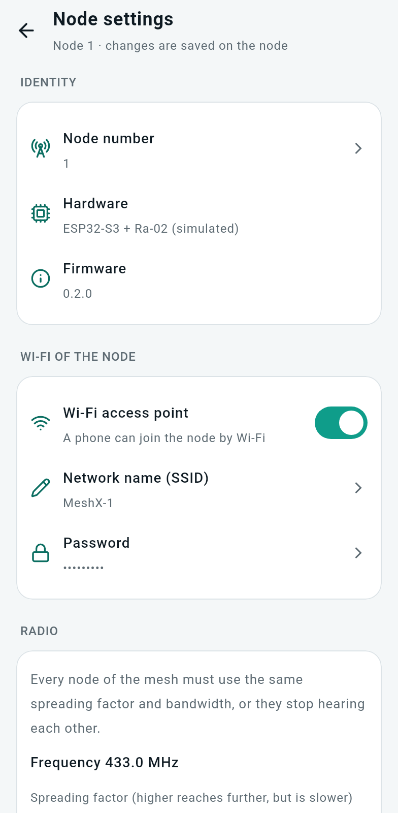

# MeshX: Adaptive Off-Grid Communication System using LoRa

Final Year Design Project, Department of Computer and Information Systems Engineering (CS-406).

MeshX is a low-cost LoRa mesh of battery-powered nodes (ESP32-S3 + SX1278 / SX1262) that lets people exchange
text messages over several kilometres with no cellular network, Wi-Fi router or internet. Each phone talks to
its nearest node over Bluetooth or the node's own Wi-Fi, and nodes forward messages for each other using a
link-quality-aware routing algorithm (RSSI, SNR, packet loss, battery) instead of blind hop count.

**Team:** Shayan Malik (CS-23053), Syyeda Fatima Shoaib (CS-23075), Umaiza Asif (CS-23080), Hamna Rizvi (CS-23082)
**Supervisor:** Dr. Sumayya Zafar · **Co-supervisor:** Sheikh Abdul Basit (NCCS)

## Repository layout

| Folder | What is in it | Status |
|---|---|---|
| [`android-app`](android-app) | Android app (Kotlin + Jetpack Compose): chat, contacts, node monitoring, network map, node settings | v0.2 |
| [`docs/protocol.md`](docs/protocol.md) | Protocol v2: phone and node, node and node | v0.2 |
| [`docs/design`](docs/design) | App screens and the first Figma design | v0.2 |
| [`docs/proposal`](docs/proposal) | Approved FYDP proposal (PDF + Word) | Done |
| [`docs/guides`](docs/guides) | Node hardware guide, Ra-02 breadboard build guide, mid-year readiness pack (open the `.html` files in a browser) | Done |
| [`hardware`](hardware) | Interactive schematic, pin map, bill of materials and price lists | Done for prototype |
| [`firmware`](firmware) | ESP32 node firmware (Arduino / PlatformIO) | Next |
| [`analysis`](analysis) | Python scripts for logs, routing comparison and graphs | Later |

New to the repo? Start with **[docs/GETTING_STARTED.md](docs/GETTING_STARTED.md)**.

## The app in one minute

| | |
|---|---|
|  |  |
|  |  |

- **Off-grid text chat** through a LoRa node (Bluetooth or Wi-Fi), or directly from phone to phone, with delivery status, hop count and retry.
- **Contacts and nodes:** add contacts by hand, from the list of heard nodes, or by QR code. See position, distance and signal strength of every node.
- **Device monitoring:** all nodes with live status, battery, link quality, routes, packet counters and a live packet log.
- **Settings:** change the Wi-Fi name and password, radio settings and network key of a node, and update its firmware, from the phone.
- **Demo mesh:** four simulated nodes inside the app, to learn and present without hardware.

## Project plan (from the proposal Gantt chart)

1. Sept–Oct: LoRa / RF / mesh research, first point-to-point ESP32 ↔ LoRa link
2. Nov: BLE bridge to Android, phone-to-phone message through two nodes
3. Dec: 4-node chain with discovery, forwarding, TTL and duplicate detection
4. Jan: reliability layer (ACKs, retransmission, store-and-forward, route recovery)
5. Feb: security layer (AES-256-GCM, node authentication)
6. Mar: adaptive routing using RSSI / SNR / loss / battery
7. Apr: comparison of adaptive vs shortest-hop vs flooding, campus field tests
8. May: results, thesis, poster, final demo
