# Android app UI/UX design

## v0.2 (current app)

These pictures are drawn by the app's own code with the demo mesh, so they always match the app.

| Screen | What it is for | Preview |
|---|---|---|
| Welcome | name of the user, one line about the idea | 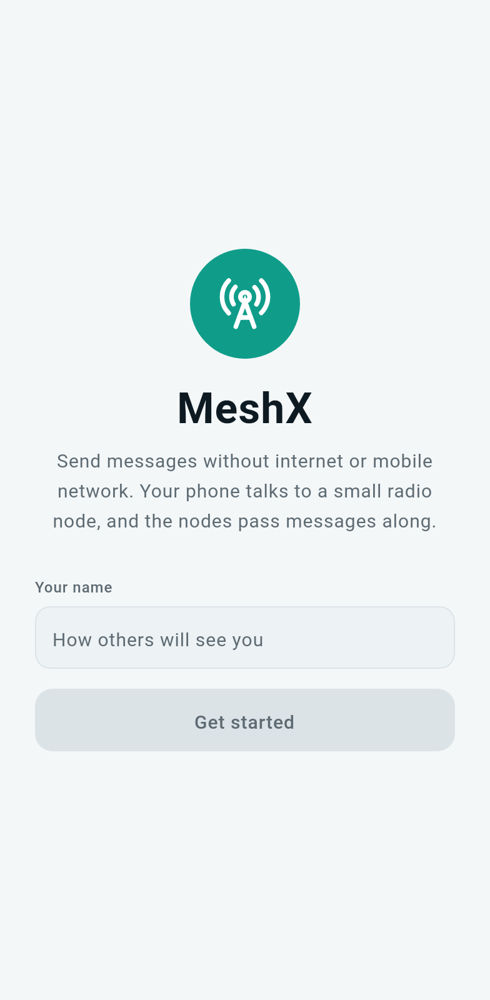 |
| Connect | four ways to connect: node over Bluetooth, node over Wi-Fi, phone to phone, demo mesh | 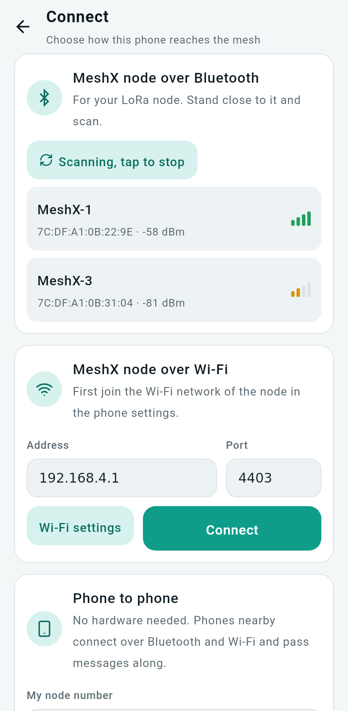 |
| Chats | conversations, unread count, channel for everyone | 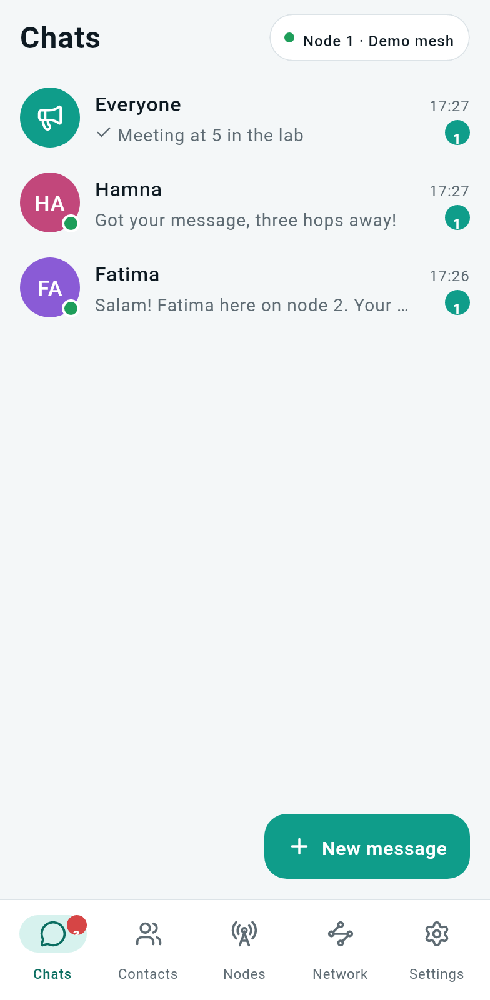 |
| Chat | messages with status (sending, sent, delivered with hops and time, failed with retry) | 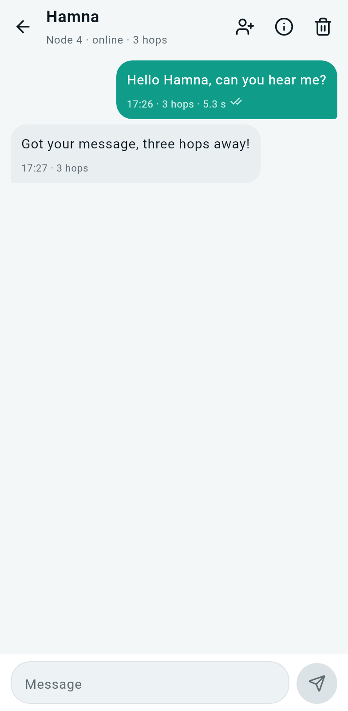 |
| Contacts | saved contacts, the list of heard nodes, QR code import | 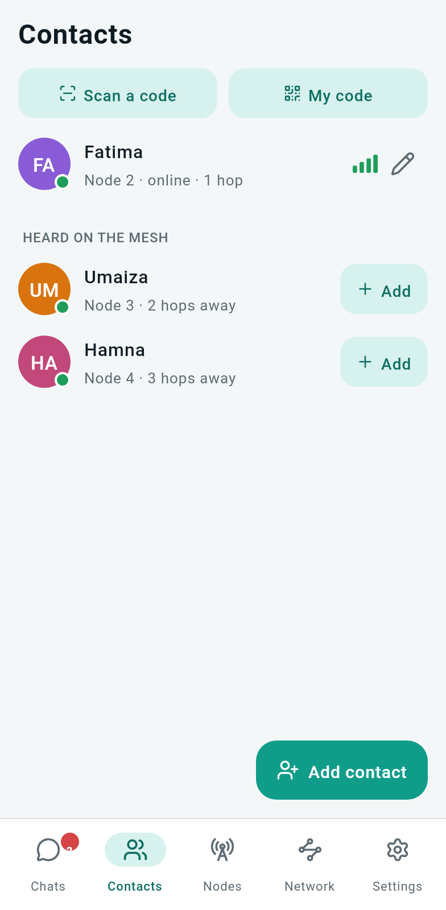 |
| Nodes | all devices with live status, signal, battery, distance | 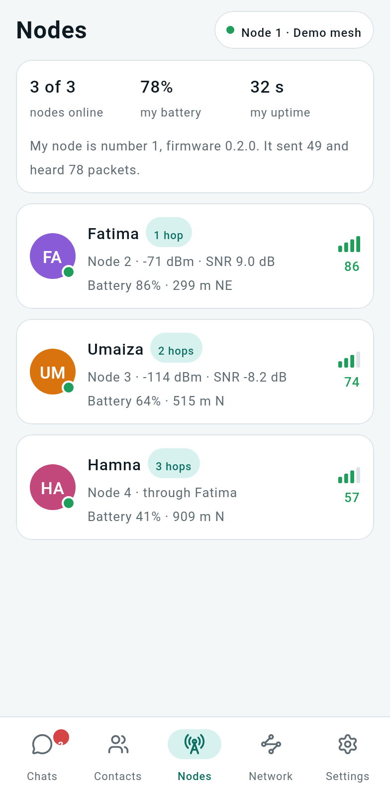 |
| Node details | signal, link score, route, counters, ping, position | 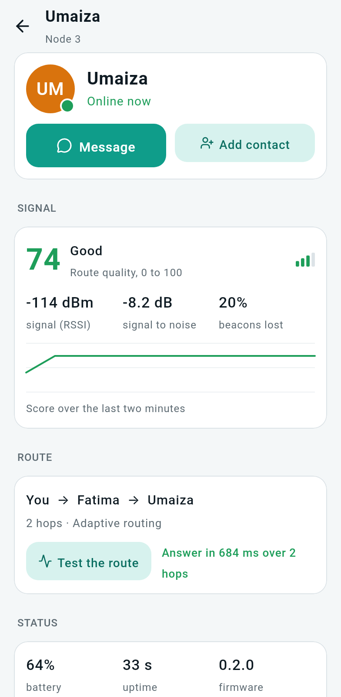 |
| Network: topology | live graph of nodes and links, routing mode switch, route in use | 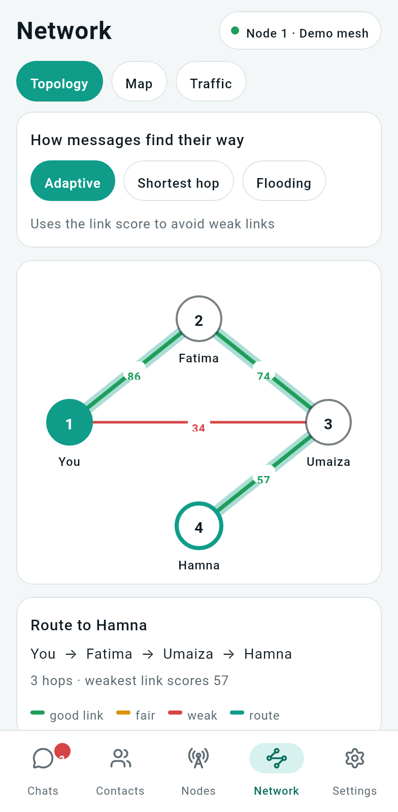 |
| Network: map | positions as distance and direction from the user | 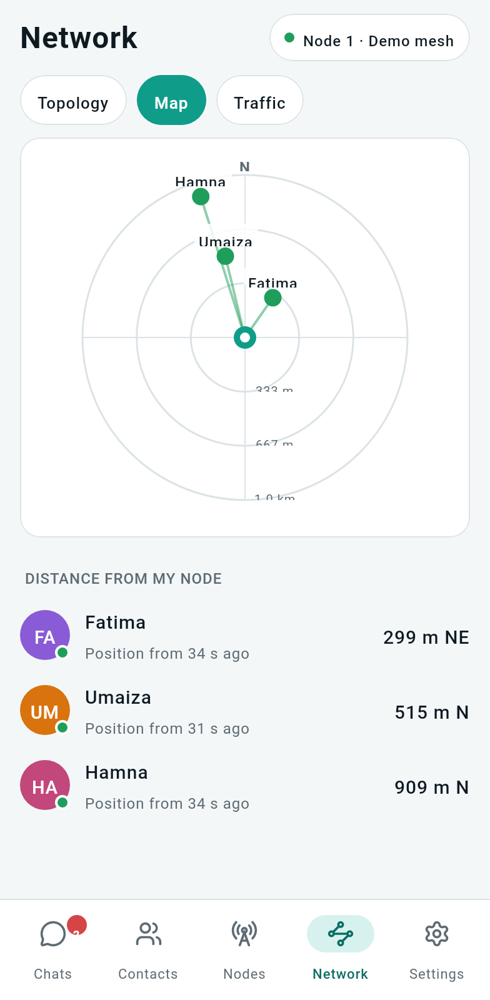 |
| Network: traffic | packet counters, packets per second, live packet log | 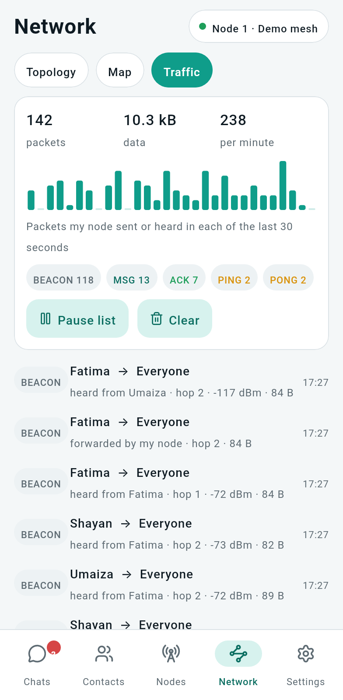 |
| Settings | profile, theme, location sharing, connection | 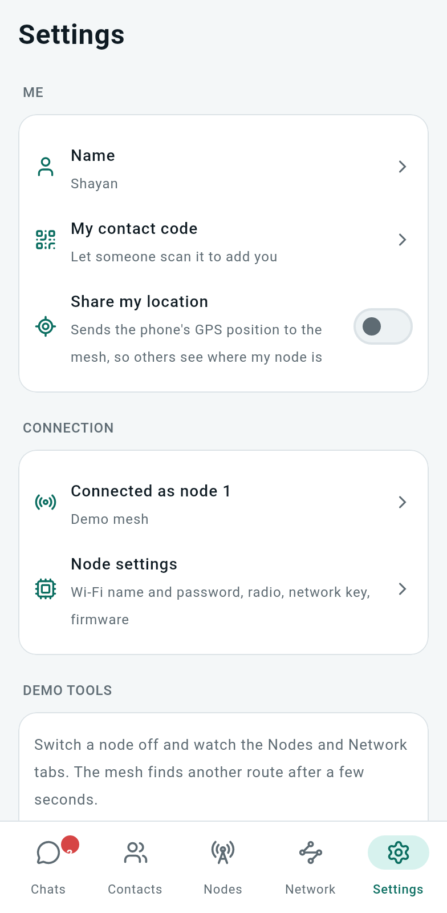 |
| Node settings | Wi-Fi name and password, radio, network key, firmware update, restart | 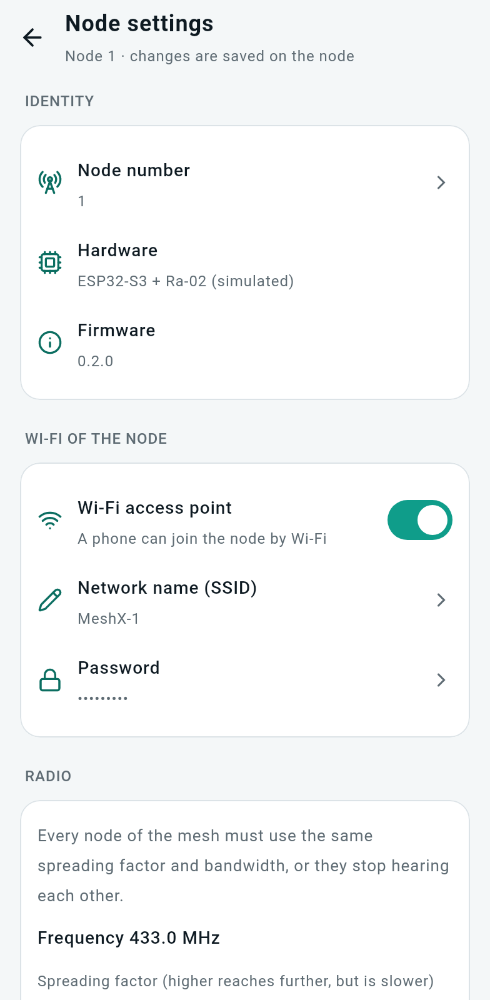 |
| Edit a setting | example: Wi-Fi password | 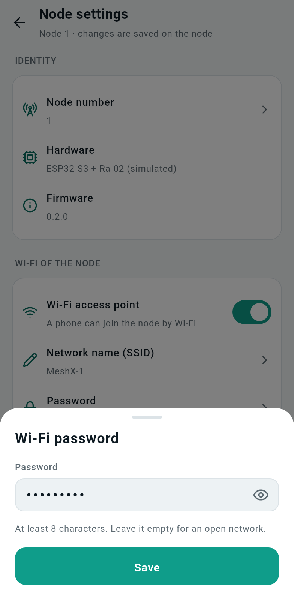 |
| My code | QR code of the user for other phones | 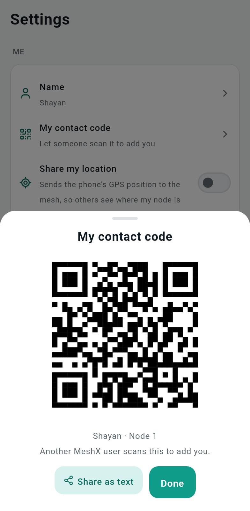 |
| Dark theme | Nodes and topology | 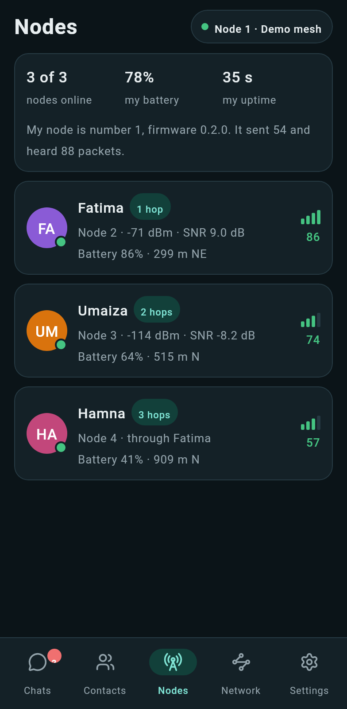 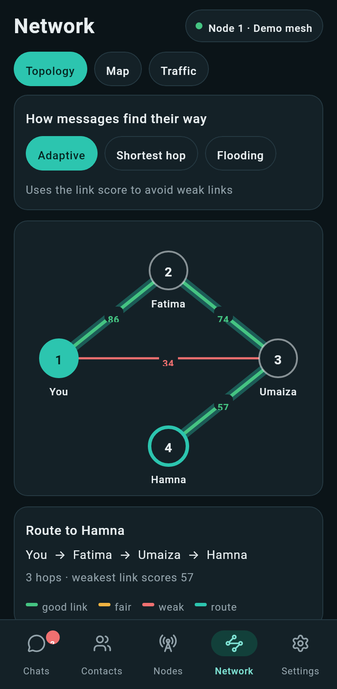 |

Design decisions:

1. Signal information is always visible (hops, signal bars, delivery status), because proving multi-hop delivery is the point of the project.
2. The routing mode switch sits on the Network tab, so adaptive, shortest-hop and flooding can be compared live.
3. The demo mesh has the four team nodes and can switch nodes off, so route recovery can be shown without hardware.
4. Large touch targets (48 dp), high contrast and a dark theme for outdoor use.
5. Colours: teal `#0F9D8A` for the mesh, see `ui/theme/Theme.kt`. Icons: [Lucide](https://lucide.dev) (ISC licence).

## v0.1 (first design in Figma)

- Figma design file (7 screens, components, style guide): https://www.figma.com/design/AcwXg0kupgabqYOPDhirem
- FigJam user flow and system schematic: https://www.figma.com/board/8ZKwC6RBukY7y6MXb6kNz0
- Exported pictures: [`figma-v0.1/`](figma-v0.1)
